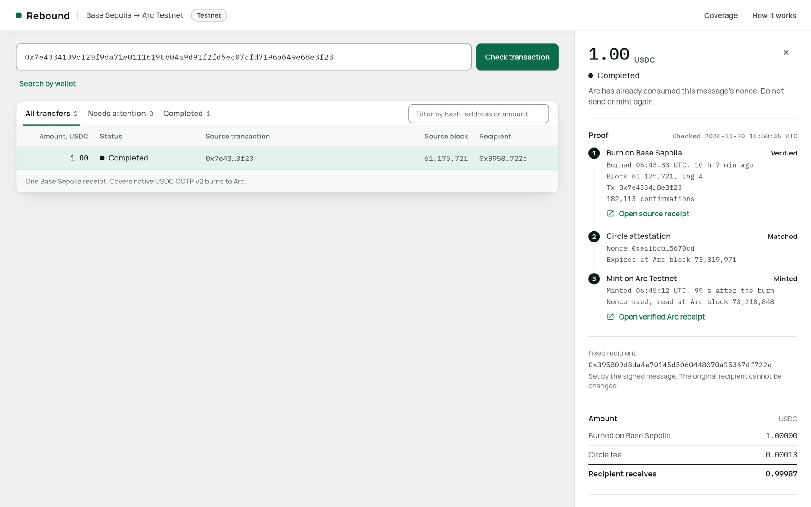
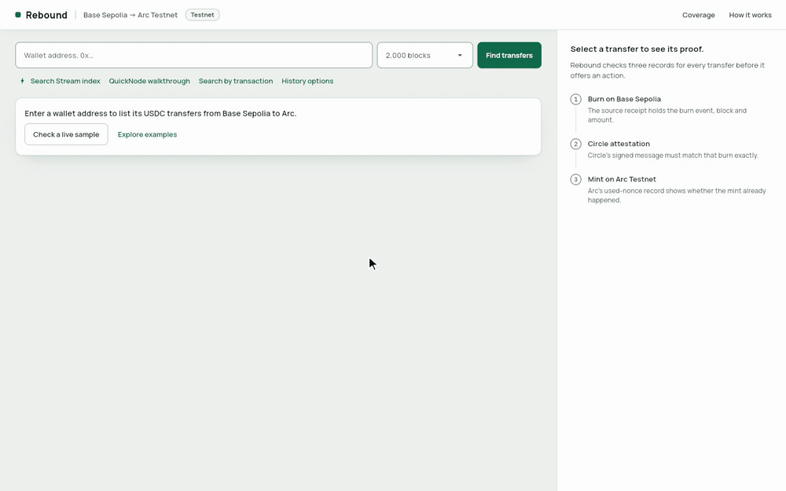
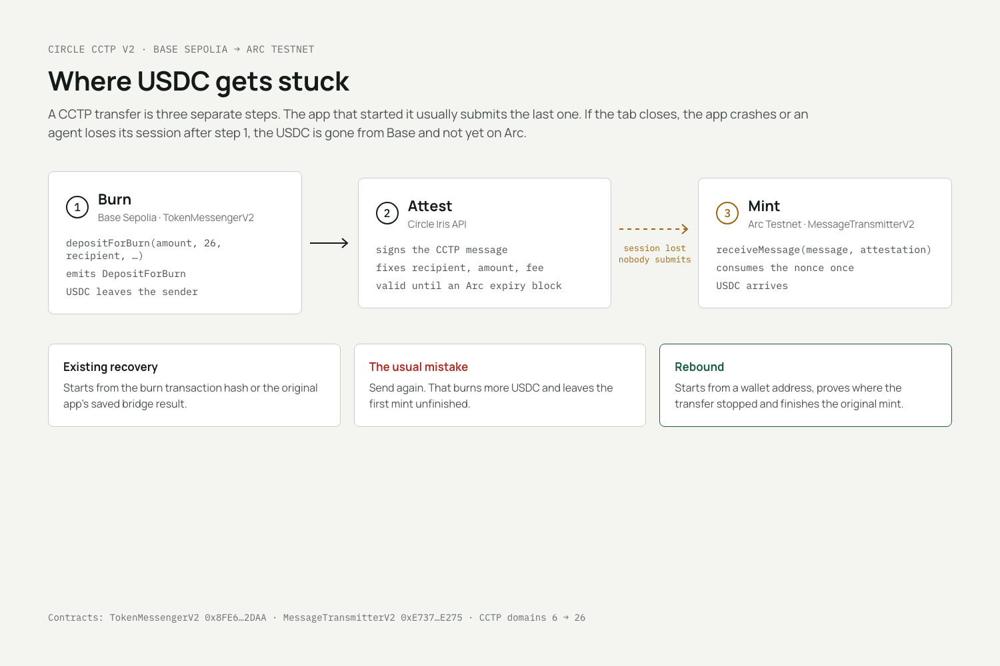
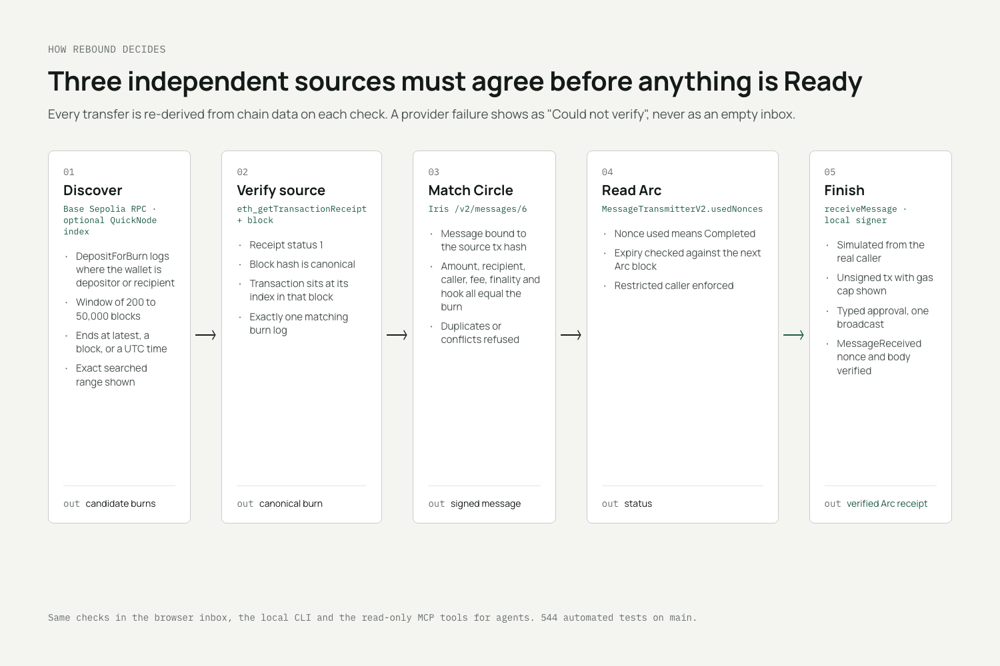
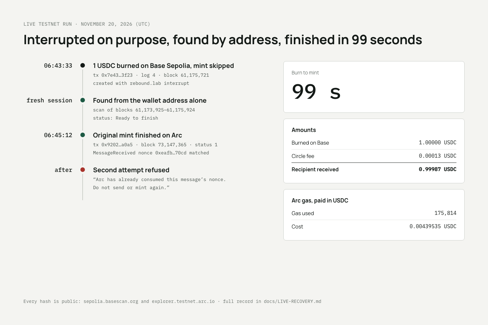
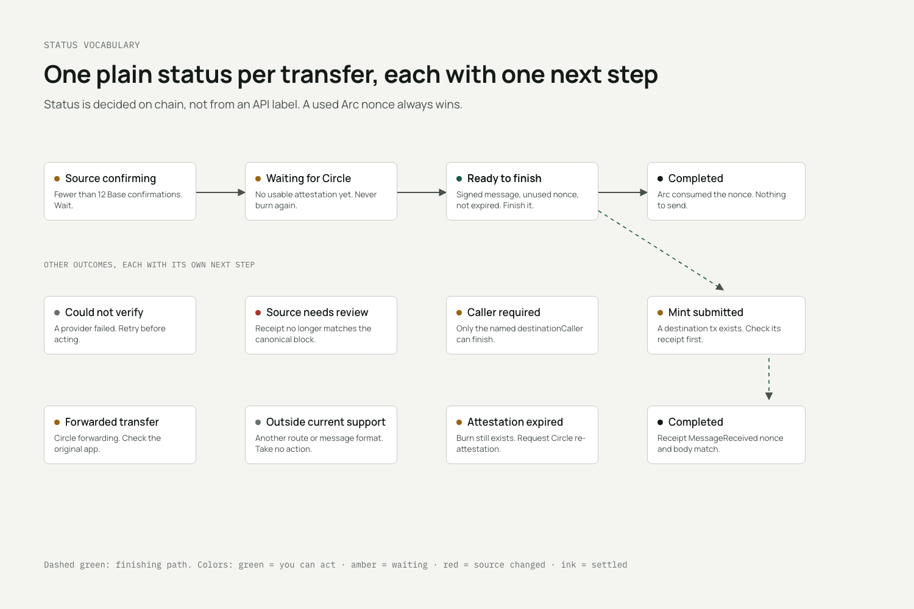
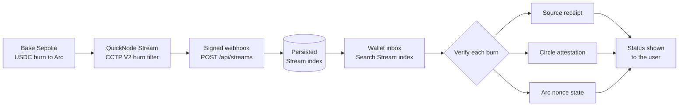

<div align="center">

# Rebound

**Find it. Prove it. Finish it.** Recover interrupted USDC transfers from Base to Arc, starting from nothing but a wallet address.

    



</div>

Rebound finds interrupted USDC transfers from a public wallet address. It checks the source receipt, matches Circle’s message and reads Arc’s nonce state so users can decide whether to wait or finish the existing transfer.

**Initial route: Base Sepolia → Arc Testnet.** Rebound uses a Python/Flet browser interface, a FastAPI backend and a local Python recovery command. A controlled 1-USDC testnet recovery verified address-only discovery, the Arc mint and the refusal to prepare a duplicate mint. [Live recovery evidence](docs/LIVE-RECOVERY.md)

Read the [PRD](docs/PRD.md), [implementation and release plan](docs/superpowers/plans/2026-11-19-rebound.md), [live demo procedure](docs/DEMO.md), [controlled testnet lab](docs/LAB.md) and [QuickNode setup](docs/QUICKNODE.md).



*Live Base Sepolia and Arc Testnet data, captured November 20, 2026.*

## See it work



*Real app, live testnet data, sped up 1.5x.*

## Submission at a glance

| Field | Entry |
|---|---|
| Team | Siddartha Kodithyala, Anay Goyal, Areeb Hirani, Parth Patel |
| Main track | DeFi and Onchain Applications |
| Chain award | Best use of Arc |
| Bounties | None claimed. The QuickNode Streams adapter is implemented, but live provider delivery of a real burn is still pending ([status](#quicknode-streams-integration)). |
| Demo video | VIDEO_LINK_TBD |
| Live evidence | [Base Sepolia source burn](https://sepolia.basescan.org/tx/0x7e4334109c120f9da71e01116190804a9d91f2fd5ec07cfd7196a649e68e3f23) → [Arc Testnet mint](https://explorer.testnet.arc.io/tx/0x92020b4554591c5afc4ae31aff0a8906fc19d1a17f2bd1773e1592762ea0a0a5), 99 s apart, then a refused duplicate. [Full record](docs/LIVE-RECOVERY.md) |
| Contracts | Existing Circle CCTP V2 contracts on Base Sepolia and Arc Testnet. [Addresses](#contracts-used) |
| Economics and risks | [Economic design and risks](#economic-design-and-risks) |

## How it works

1. **Find.** Enter a public wallet address. Rebound scans Circle TokenMessengerV2 `DepositForBurn` events on Base Sepolia where the address is the depositor or the mint recipient, and states the exact block range searched.
2. **Verify the source.** It re-fetches the canonical Base Sepolia receipt and checks the burn is still at its position in the canonical block.
3. **Match Circle.** It pulls the signed message from Circle's attestation API and compares amount, recipient, caller restriction, fee, finality and hook against the original burn.
4. **Read Arc.** It reads `usedNonces` on Arc's MessageTransmitterV2. A used nonce means Completed, whatever Circle's status says; an unused nonce with a valid attestation means Ready to finish.
5. **Finish once.** For a ready transfer, it simulates `receiveMessage(message, attestation)` on Arc from your caller and shows the unsigned transaction. The local CLI signs and broadcasts once after explicit approval, then checks the Arc `MessageReceived` event against the original nonce.









## Try it in two minutes

After [running locally](#run-locally), follow the same steps as the demo video. Everything below reads public testnet state; nothing is signed in the browser.

1. **Find by address.** Open `http://127.0.0.1:8765`, paste `0x395809d8da4a70145d5060448070a15367df722c` and select **Check a live sample**. Rebound scans a fixed 200-block Base Sepolia window ending at block 61,175,721 and finds the controlled 1 USDC transfer.
2. **Read the proof.** Select the row. The inspector shows the verified Base burn, the matched Circle attestation and the completed Arc mint, 99 s after the burn, with a link to the verified Arc receipt.
3. **Review a recovery.** Open `http://127.0.0.1:8765/transfer/0x9064f18850c6a86cdea854175835f8eabb3a20eb06a2f1598f6fa0675cc950b5/5`, a second real burn that was still unminted on November 20. Under **Finish the transfer**, enter `0x395809d8da4a70145d5060448070a15367df722c` and select **Review recovery**. Rebound simulates `receiveMessage` on Arc and shows the unsigned transaction and gas budget in USDC. If someone has finished it since, the inspector shows **Completed**; once Arc passes block 73,321,951 its attestation expires and the inspector shows **Attestation expired** instead.
4. **See the duplicate refusal.** Run `uv run python -m rebound.cli prepare 0x7e4334109c120f9da71e01116190804a9d91f2fd5ec07cfd7196a649e68e3f23 4 --caller 0x395809d8da4a70145d5060448070a15367df722c`. It exits with "Transfer is completed. Arc has already consumed this message's nonce. Do not send or mint again."
5. **Explore every state.** Open `http://127.0.0.1:8765/demo` for clearly labelled synthetic examples of Waiting for Circle, Caller required and the other states.

## Run locally

Requires Python 3.13+ and [uv](https://docs.astral.sh/uv/getting-started/installation/).

```bash
uv sync
uv run uvicorn rebound.app:app --host 127.0.0.1 --port 8765
```

Open `http://127.0.0.1:8765`. The app's UI is written in Python using Flet controls and rendered by Flutter. Application code does not author HTML, CSS or TypeScript. The small JavaScript file under `streams/` is an optional provider-side QuickNode filter, not a web application.

Default public RPCs can be rate-limited or restrict historical log queries. For your own endpoints, copy `.env.example` to `.env`, update it and launch with:

```bash
uv run --env-file .env uvicorn rebound.app:app --host 127.0.0.1 --port 8765
```

Keep `.env`, RPC credentials and signing keys out of Git. `REBOUND_DB` selects a writable SQLite path. Set `REBOUND_STREAM_SECURITY_TOKEN` to validate QuickNode signatures, or use `REBOUND_STREAM_SECRET` for local adapter checks. Ingestion is disabled by default. Production hosting additionally needs HTTPS, durable storage and an abuse/load review.

`/api/health` checks that the app is running. `/api/ready` checks both chain IDs and configured contracts, plus Circle’s Base-to-Arc fee route. A readiness result reports which provider failed. Use the live sample to verify the full attestation and receipt path.

The browser and API share a bounded verification queue. When it fills, the API returns 429 with a retry delay and the inbox shows a retry message. The same time limit covers both queueing and active verification. [OWASP API resource consumption](https://api-security.owasp.org/editions/2023/en/0xa4-unrestricted-resource-consumption/)

## Find and prepare transfers

The browser app scans by public address. It displays the exact source block range and whether results are partial. An empty inbox means no supported transfers were found **within the stated coverage**, not that the wallet has no unfinished transfers anywhere.

The same service is available locally:

```bash
uv run python -m rebound.cli --help
uv run python -m rebound.cli scan "$WALLET_ADDRESS" --blocks 2000
uv run python -m rebound.cli scan "$WALLET_ADDRESS" --blocks 200 --end-block 61125511
uv run python -m rebound.cli inspect "$BURN_TX_HASH"
uv run python -m rebound.cli replay "$BURN_TX_HASH" "$LOG_INDEX"
uv run python -m rebound.cli prepare "$BURN_TX_HASH" "$LOG_INDEX" --caller "$CALLER_ADDRESS"
```

Set those variables to your own public address, the original burn hash and the decimal `DepositForBurn` log index shown in the inbox. `prepare` exports an unsigned destination transaction only after fresh source/message/nonce checks and destination simulation. It does not send anything or request a key.

The local MCP server exposes discovery, inspection, readiness and unsigned preparation to Codex and other MCP clients. [MCP setup](docs/MCP.md)

Use **History options** to end an address scan at a Base Sepolia block or a UTC time. Choose a time after the transfer. Rebound resolves it to the latest available block at or before that time and scans backward by the selected number of blocks. The result reports the exact blocks searched, and transfer status reflects current chain state. When Circle supplies a destination transaction hash for a completed transfer, Rebound links to Arc after checking the successful receipt and its matching CCTP event. [Base block API](https://docs.base.org/base-chain/api-reference/ethereum-json-rpc-api/eth_getBlockByNumber)

**Refresh this transfer** rechecks the selected source receipt, matching Circle message and Arc nonce without rerunning the wallet scan. **Copy evidence** copies the public transfer identifiers, amounts, verification time and receipt links for a support ticket or demo.

When a completed transfer lacks a receipt link, paste the Arc transaction hash in the inspector and select **Verify Arc receipt**. Rebound checks that the canonical Arc receipt contains the original mint message and nonce, then adds its verified link.

**Copy case link** opens the exact source transaction and event index on the same Rebound deployment. The recipient of the link gets a fresh chain check.

Open `/demo` or search for `0x05af7613449b84f2a02893d35e6cdee479404ce8` to use the synthetic wallet. **Show simulated Stream delivery** opens an example of the Stream discovery workflow. This demo uses local fixture data and cannot prepare a transaction.

For a real Base Sepolia backfill, select **Check a live sample** or scan the controlled run's fixed window. The default 2,000-block window ends at the current head and no longer reaches this burn. The command returns the completed 1-USDC transfer and its verified Arc receipt:

```bash
uv run python -m rebound.cli scan 0x395809d8da4a70145d5060448070a15367df722c --blocks 200 --end-block 61175721
```

The same transfer can be found from a UTC time after the burn. A time without seconds ends at the start of that minute.

```bash
uv run python -m rebound.cli scan 0x395809d8da4a70145d5060448070a15367df722c --blocks 200 --end-time 2026-11-20T06:44Z
```

The [validation notes](docs/VALIDATION.md#reproduce-the-read-only-check) include an independent historical case.

For a completed direct mint, **Replay historical mint** verifies the original receipt, reads the nonce at the previous block and the receipt block, then simulates the same attestation against the previous block. The replay requires an Arc RPC that serves historical state and uses reads only.

### Complete a transfer locally

For an eligible **testnet** transfer, use a throwaway testnet account with destination gas:

```bash
uv run python -m rebound.cli recover "$BURN_TX_HASH" "$LOG_INDEX" --caller "$CALLER_ADDRESS"
```

The command decodes the destination transaction and checks its recipient, original amount, net amount and protocol fee against the review. It shows estimated gas separately. It requires typing `RECOVER` before requesting a hidden local key, checks that the key belongs to the approved caller, and prepares the transfer again immediately before signing. It sends at most once and checks the receipt event against the original message body and nonce. The default maximum gas cost is **0.1 testnet USDC**. Use `--max-gas-usdc` to adjust the local cap.

The private key is never accepted by a web endpoint, written to a file or printed. Python cannot guarantee erasure of secrets from process memory. Use a dedicated test account, not an account holding real assets. If submission times out, the command reports the locally computed transaction hash and does **not** automatically resubmit. Inspect that hash and re-diagnose before another attempt.

Run the CLI and inbox with the same `REBOUND_DB` to see a locally recovered receipt before Circle indexes its destination hash. The CLI saves the verified destination hash and the inbox checks the receipt against the current signed message before linking to it.

The unsigned review shows the caller’s Arc balance and gas budget separately from the CCTP protocol fee. Arc gas uses the native USDC balance in 18-decimal units. The CLI checks the caller’s pending balance before asking for a key and checks it again before signing. [Arc wallet integration guide](https://community.arc.io/public/externals/supporting-arc-in-wallets-one-balance-usdc-fees-and-complete-history-2026-09-10)

## What the states mean

| State | Meaning and next step |
|---|---|
| Source confirming | The source burn needs more confirmations; refresh later |
| Waiting for Circle | Circle has not returned a usable signed message yet; do not burn again |
| Ready to finish | Current checks allow preparation; select the actual caller and revalidate |
| Caller required | The message restricts who can call the destination contract; the recipient is not automatically authorized |
| Attestation expired | The existing burn needs a refreshed attestation. [Circle's re-attestation procedure](https://developers.circle.com/cctp/references/technical-guide#message-body) |
| Forwarded transfer | The burn requested Circle forwarding. Check the original app while Arc’s nonce is unused. |
| Completed | Destination nonce is already consumed; another mint is unnecessary |
| Source needs review | Source evidence no longer matches the canonical receipt/block; inspect rather than sending |
| Outside current support | The route, message, hook or adapter is outside this version's coverage |
| Mint submitted | A destination transaction was submitted; check its receipt before attempting another mint |
| Could not verify | A required source could not be verified; no recovery transaction is prepared. Try again before taking any action |

Circle's attestation status `complete` is **not** proof that the destination mint happened. The original recipient cannot be changed. Recovery here means finishing an existing mint, not refunding or reversing a transfer.

## Architecture

```text
Python Flet interface ─┐
FastAPI endpoints ────┼── RecoveryService ── Base Sepolia RPC
Local Python CLI ────┘          │          ├─ Circle sandbox attestation API
                               │          └─ Arc Testnet RPC
                       SQLite candidates
                               ▲
                 Authenticated Stream ingestion
```

`protocol.py` decodes packed messages and checks invariants. `clients.py` handles RPC and Circle responses. `store.py` indexes candidates. `service.py` discovers and reconciles transfers and prepares unsigned transactions. `ui.py` renders the browser experience. `app.py` mounts the API and Flet. `cli.py` signs recovery transactions locally. A Stream or cached row can suggest a transfer for inspection. The recovery service verifies each transfer independently before preparation.

### Contracts used

| Item | Value |
|---|---|
| Source | Base Sepolia, chain `84532`, CCTP domain `6` |
| Destination | Arc Testnet, chain `5042002`, CCTP domain `26` |
| Source USDC (Base Sepolia) | `0x036CbD53842c5426634e7929541eC2318f3dCF7e` |
| TokenMessengerV2 (Base Sepolia, emits `DepositForBurn`) | `0x8FE6B999Dc680CcFDD5Bf7EB0974218be2542DAA` |
| MessageTransmitterV2 (Arc Testnet, `usedNonces` and `receiveMessage`) | `0xE737e5cEBEEBa77EFE34D4aa090756590b1CE275` |
| Attestation service | `https://iris-api-sandbox.circle.com` |

These are existing Circle contracts; Rebound has not deployed a new protocol. See the [canonical addresses](https://developers.circle.com/cctp/references/contract-addresses) and [message source](https://github.com/circlefin/evm-cctp-contracts/tree/master/src/messages/v2). Network IDs and deployed bytecode are checked before use. CCTP itself enforces one successful mint per nonce; Rebound does not invent that guarantee. Racing or reverted transactions can still consume gas.

### Economic design and risks

- **Original principal.** Circle’s contracts burn the original USDC on Base Sepolia and mint on Arc to the recipient already encoded in the message. Rebound holds no balance and takes no fee.
- **Costs.** Circle’s protocol fee comes out of the original amount and is bounded by the source burn’s maximum fee. The destination caller pays Arc gas in testnet USDC. The local recovery command prints a separate gas estimate and applies a caller-selected cap.
- **Settlement.** Arc’s consumed nonce prevents another mint of the same message. Competing submissions can spend gas even when only one mint succeeds. Rebound checks the nonce again immediately before preparing a signed recovery.
- **Dependencies.** The flow depends on a canonical confirmed source receipt, Circle’s valid attestation, current Arc chain state and a funded authorized caller. The app bounds discovery to the displayed coverage and checks the original destination caller before simulation.

**UBC track fit.** Rebound is entered in DeFi and Onchain Applications and for Best Use of Arc. The organizer’s guide includes CCTP cross-chain flows in DeFi and allows existing Arc contracts. QuickNode Streams requires a configured live source and destination. [Official hackathon guide](https://docs.google.com/document/d/1QaySCo7u3VxMVNdk3C5Ab3ewc2E46AuLntti-Uzx5EY/edit)

## How Rebound uses Arc

Arc Testnet (chain `5042002`, CCTP domain `26`) is where every transfer Rebound handles settles. The core decisions are made from Arc state:

- **Completed or not.** Rebound calls `usedNonces(nonce)` on Arc's MessageTransmitterV2 (`0xE737e5cEBEEBa77EFE34D4aa090756590b1CE275`). A consumed nonce means the mint already happened, so Rebound refuses to prepare another one. It reads the message's expiry block against the current Arc block.
- **Finishing the original mint.** For a ready transfer, Rebound simulates `receiveMessage(message, attestation)` on Arc from the caller's address and returns the unsigned zero-value transaction for chain `5042002`. The local CLI signs and submits it once.
- **USDC as gas.** Arc's native gas token is USDC, so the review shows the caller's Arc balance (18-decimal native units) and the gas budget in USDC, next to Circle's protocol fee and the net mint. Fees and balances stay in one stable unit.
- **Receipt proof.** After a mint, Rebound checks the Arc receipt for a `MessageReceived` event matching the original nonce and message body before linking to it. The chain ID and deployed bytecode of the Arc contract are checked before each use (`/api/ready` reports this).
- **Live run.** The controlled transfer was minted on Arc in [`0x9202…a0a5`](https://explorer.testnet.arc.io/tx/0x92020b4554591c5afc4ae31aff0a8906fc19d1a17f2bd1773e1592762ea0a0a5), 99 seconds after its [Base Sepolia burn](https://sepolia.basescan.org/tx/0x7e4334109c120f9da71e01116190804a9d91f2fd5ec07cfd7196a649e68e3f23). A second preparation was refused because the Arc nonce was used.

## QuickNode Streams integration

Rebound integrates QuickNode Streams to help users find interrupted USDC transfers with just a public wallet address. A configured Stream can monitor Base Sepolia for Circle CCTP V2 USDC burn events and send matching events to Rebound’s authenticated webhook. Independent observation of a real burn arriving from the provider remains pending.

The public preview requires no credentials, wallet connection or QuickNode account. Enter a public testnet address only. Provider setup is an operator task; tokens and optional private RPC URLs stay in server environment variables.

**Why QuickNode Streams.** A user who lost their session may have only an address. RPC history scans are bounded by a selected window and provider retention or query limits. A configured Stream can filter incoming blocks and persist matching burns for later wallet lookup. An index lookup reads the database, then checks the source receipt, Circle and Arc independently.

When a user selects **Search Stream index**, Rebound looks up events associated with their wallet in the persisted Stream index and checks the original burn receipt, Circle’s attestation, and Arc’s on-chain state. This search reads the index only and does not fall back to a source RPC history scan. The user can see whether the transfer is pending, ready to finish, or already complete without looking up the original transaction hash.



| Setting | Value | Why it matters |
|---|---|---|
| Network | Base Sepolia (chain 84532) | Circle’s TokenMessengerV2 emits the burn here. |
| Dataset | Block with Receipts (`block_with_receipts`) | The filter reads raw logs from each receipt, so it sees the burn without extra RPC calls. |
| Filter | [`streams/filter.js`](streams/filter.js): successful receipt, TokenMessengerV2 address, `DepositForBurn` topic and native Base Sepolia USDC topic | Only canonical USDC burns are delivered. Blocks with no match are not delivered. The Python decoder still enforces the Arc destination and message fields. |
| Webhook | `POST /api/streams`, HMAC over nonce, timestamp and body, 15 minute window, plain or gzip JSON | In signature mode, the configured Security token authenticates the payload. Shared-secret mode is reserved for local adapter checks. |
| Index | SQLite, with the delivery time and signature status of each burn | The wallet search needs no RPC history scan and can say how each result arrived. |

**Author-recorded dashboard snapshot (2026-11-20).** The same record is bundled in [`rebound/stream_record.json`](rebound/stream_record.json). It is a dated contributor report, not a live dashboard query or an independently verified current provider status.

| Field | Reported value |
|---|---|
| Name / Stream ID | Rebound Base Sepolia burns / `c797f5ca-9aa8-4874-b8f1-a291a4066f27` |
| Source | Base Sepolia, Block with Receipts |
| Start / batches | Block 61,159,868, no end, batches of 1 |
| Filter / destination | Author reports `streams/filter.js` and `POST /api/streams` with token authentication |
| State recorded on 2026-11-20 | **Terminated**; last reported block 61,175,720; 15,861 blocks processed (dashboard count), 0 blocks sent, 8 errors |

The last reported block precedes the controlled burn at 61,175,721. This snapshot does not establish the cause of termination or that zero sends means zero matching burns. It supplies no successful provider delivery record for the controlled burn. Current state and end-to-end provider delivery remain unverified.

How a result is labelled depends on how it arrived:

| Delivery | Label in the inspector | Independently proves provider delivery |
|---|---|---|
| Valid HMAC using the configured token and matching block hash | **Authenticated Stream payload** | No; a local signed replay can pass the same checks |
| Fresh local shared-secret record (`REBOUND_STREAM_SECRET`) | **Shared-secret adapter payload** | No; an existing authenticated record retains its earlier authentication evidence |
| Legacy record without stored receipt time or HMAC evidence | **Stream endpoint record** | No |
| Demo wallet fixture | Simulated Stream delivery | No |

For a Stream-found transfer the inspector separates the source burn, authenticated payload and transfer status evidence: the Base Sepolia block, a link to the original burn, the endpoint receipt time, and the source, Circle and Arc checks. **Authenticated Stream payload** means that the configured token validated the payload and its block hash matched. It does not establish who sent the request. Provider observation requires a separate matching dashboard delivery record and canonical source receipt. QuickNode does not report block coverage to Rebound, so an empty result is not proof that no transfer exists.

**Validation status.** The checks are tracked separately. Simulations and the local adapter are never counted as a live delivery.

| Check | Result | Evidence | Status |
|---|---|---|---|
| Signed sample delivery | QuickNode **Send Payload** passed | [Webhook setup test](docs/QUICKNODE.md#webhook-setup-test) | Observed |
| Stream configuration and state | Author-recorded dashboard snapshot above; current state not independently verified | `rebound/stream_record.json`, dated 2026-11-20 | Reported snapshot |
| Filter contract | Constants match the protocol, and the filter keeps only successful canonical USDC burns | `tests/test_quicknode.py` | Verified |
| Simulated delivery | Synthetic example shows the labelled flow | Demo wallet, **Show simulated Stream delivery** | Simulated |
| Local adapter delivery | Real controlled burn (block 61,175,721, log 4) passed through a locally signed gzip replay and wallet-only index lookup; source receipt, Circle attestation and completed Arc mint matched | Local run, 2026-11-20; authentication is endpoint evidence only | Verified as adapter test |
| Live Stream delivery of a real burn | Not yet independently observed | Needs a matching provider dashboard delivery record, endpoint payload and canonical source receipt | Pending |
| Wallet-only discovery from a live delivery | Not yet observed | Follows the live delivery | Pending |
| Completed Arc mint tied to a live delivery | The controlled burn’s mint is complete ([evidence](docs/LIVE-RECOVERY.md)) but is not yet tied to a live delivery | Follows the live delivery | Pending |

See the [QuickNode setup guide](docs/QUICKNODE.md) for configuration and verification steps, and the [recording sequence](docs/DEMO.md#quicknode-streams-walkthrough).

## Checks

```bash
uv run --locked pytest -q   # 544 tests
uv run ruff check .
```

Use `uv run python scripts/watch_prs.py --interval 900 --hours 6` to record pull requests and changed heads every 15 minutes. The watcher uses the authenticated GitHub CLI. Review and merge decisions use the exact tested head.

Use `uv run python scripts/check_preview.py "$PREVIEW_URL"` to check an HTTPS deployment’s liveness, provider readiness, demo entry, verified transfer timeline and historical replay.

Protocol tests exercise message fields, recipient/caller/amount matching, malformed input, nonce completion and expiry. Service tests use HTTP-level fixtures around the real discovery/reconciliation code. CLI tests use a fixed throwaway key and isolated RPC doubles: they verify caller and chain guards, fee caps, confirmation, fresh revalidation, signed sender, exactly one broadcast attempt and receipt evidence. Automated tests alone do not prove a real recovery; the [November 20 live run](docs/LIVE-RECOVERY.md) does.

## Coverage and remaining work

- Scans default to 2,000 source blocks and cap at 50,000; provider limits and retained index coverage affect discovery.
- Discovery covers canonical native USDC `DepositForBurn` events from the supported TokenMessengerV2 to Arc. Rebound checks Circle-forwarded mints in read-only mode. For forwarding with an app hook, the verified receipt establishes the CCTP mint and the original app handles downstream actions. Manual recovery is available for eligible hook-free burns. [Circle forwarding formats](https://developers.circle.com/cctp/concepts/forwarding-service#hook-format)
- Source and destination RPCs, Circle indexing and gas availability remain external dependencies.
- No seed recovery, arbitrary crypto recovery, loss insurance, mainnet support or recipient redirection.
- Browser wallet signing, durable hosting and an observed live QuickNode delivery remain open. The demo wallet is a synthetic fixture.
- Originality, recurring use, user demand and willingness to pay remain hypotheses rather than validated metrics.

## Final release gates

The [November 20 run](docs/LIVE-RECOVERY.md) records the receipts, screenshots and commands for the first four gates.

- [x] **Controlled source burn**. The testnet lab created a 1-USDC manual transfer to an owned recipient with zero destination caller and preserved the Base receipt.
- [x] **Fresh-session discovery**. An empty inbox found the burn from the wallet address alone and displayed it as ready to finish.
- [x] **Actual destination mint**. The locally signed Arc receipt matched the original nonce and credited 0.99987 USDC to the fixed recipient.
- [x] **Second attempt blocked as completed**. A repeated preparation for the same source hash and log returned the completed-state refusal before signing.
- [ ] **Real QuickNode delivery:** configure an actual Stream, filter and HTTPS destination; preserve its Stream ID, configuration, history range and observed delivery of a known burn into the inbox. A filter file, local fixture or synthetic webhook is insufficient.
- [ ] **Accessible deployment and wallet experience:** verify the public app on desktop and mobile, document the current local-signing handoff, and complete a browser wallet connector before claiming seamless browser signing.
- [ ] **Submission evidence:** publish the tested source revision, setup instructions and an accessible 2–3 minute video. Keep example data labeled and separate from live receipt evidence.

Follow [the detailed demo checklist](docs/DEMO.md). No checked box should imply mainnet recovery, universal history coverage or a guaranteed award.

## Container

```bash
docker build -t rebound .
test -f .env || cp .env.example .env
docker run --rm -p 8765:8765 --env-file .env -v rebound-data:/app/data rebound
```

The container runs the web app as a non-root user. Keep signing keys out of it; local signing is intentionally separate.

Deploy the same container to a public preview with the [Render blueprint](docs/DEPLOY.md).
