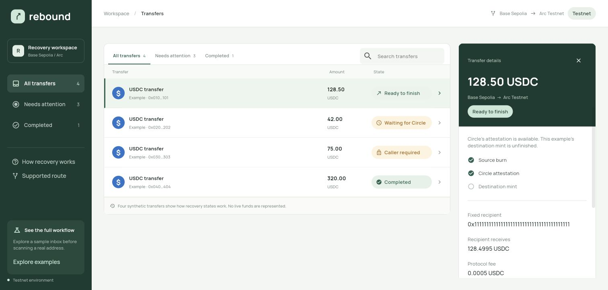

# Rebound

Rebound finds interrupted USDC transfers from a public wallet address. It checks the source receipt, matches Circle’s message and reads Arc’s nonce state so users can decide whether to wait or finish the existing transfer.

**Initial route: Base Sepolia → Arc Testnet.** This is a testnet prototype, with a Python/Flet browser interface, a FastAPI backend and a local Python recovery command. Browser wallet signing, public hosting and a recorded end-to-end testnet recovery remain separate release gates. Example transfers are synthetic and labeled; they are never claimable funds.

Read the [PRD](docs/PRD.md), [implementation and release plan](docs/superpowers/plans/2026-11-19-rebound.md), [live demo procedure](docs/DEMO.md) and [QuickNode setup](docs/QUICKNODE.md).



## Run locally

Requires Python 3.13+ and [uv](https://docs.astral.sh/uv/getting-started/installation/).

```bash
uv sync
uv run uvicorn rebound.app:app --host 127.0.0.1 --port 8765
```

Open `http://127.0.0.1:8765`. The app's UI is written in Python using Flet controls and rendered by Flutter. Application code does not author HTML, CSS or TypeScript. The small JavaScript file under `streams/` is an optional provider-side QuickNode filter, not a web application.

Default public RPCs can be rate-limited or restrict historical log queries. For your own endpoints, copy `.env.example` to `.env`, update it and launch with:

```bash
uv run --env-file .env uvicorn rebound.app:app --host 127.0.0.1 --port 8765
```

Keep `.env`, RPC credentials and signing keys out of Git. `REBOUND_DB` selects a writable SQLite path. Set `REBOUND_STREAM_SECURITY_TOKEN` to validate QuickNode signatures, or use `REBOUND_STREAM_SECRET` for local adapter checks. Ingestion is disabled by default. Production hosting additionally needs HTTPS, durable storage and an abuse/load review.

## Find and prepare transfers

The browser app scans by public address. It displays the exact source block range and whether results are partial. An empty inbox means no supported transfers were found **within the stated coverage**, not that the wallet has no unfinished transfers anywhere.

The same service is available locally:

```bash
uv run python -m rebound.cli --help
uv run python -m rebound.cli scan "$WALLET_ADDRESS" --blocks 2000
uv run python -m rebound.cli scan "$WALLET_ADDRESS" --blocks 200 --end-block 61125511
uv run python -m rebound.cli inspect "$BURN_TX_HASH"
uv run python -m rebound.cli replay "$BURN_TX_HASH" "$LOG_INDEX"
uv run python -m rebound.cli prepare "$BURN_TX_HASH" "$LOG_INDEX" --caller "$CALLER_ADDRESS"
```

Set those variables to your own public address, the original burn hash and the decimal `DepositForBurn` log index shown in the inbox. `prepare` exports an unsigned destination transaction only after fresh source/message/nonce checks and destination simulation. It does not send anything or request a key.

Use **History options** in the browser or `--end-block` in the CLI to revisit a fixed source block window. The fixed range includes only burns in that window. Transfer status still reflects current chain state. When Circle supplies a destination transaction hash for a completed transfer, Rebound links to Arc after checking the successful receipt and its matching CCTP event.

**Refresh this transfer** rechecks the selected source receipt, matching Circle message and Arc nonce without rerunning the wallet scan. **Copy evidence** copies the public transfer identifiers, amounts, verification time and receipt links for a support ticket or demo.

**Copy live case link** opens the exact source transaction and event index on the same Rebound deployment. The recipient of the link gets a fresh chain check.

For a completed direct mint, **Replay historical mint** verifies the original receipt, reads the nonce at the previous block and the receipt block, then simulates the same attestation against the previous block. The replay requires an Arc RPC that serves historical state and uses reads only.

### Complete a transfer locally

For an eligible **testnet** transfer, use a throwaway testnet account with destination gas:

```bash
uv run python -m rebound.cli recover "$BURN_TX_HASH" "$LOG_INDEX" --caller "$CALLER_ADDRESS"
```

The command decodes the destination transaction and checks its recipient, original amount, net amount and protocol fee against the review. It shows estimated gas separately. It requires typing `RECOVER` before requesting a hidden local key, checks that the key belongs to the approved caller, and prepares the transfer again immediately before signing. It sends at most once and checks the receipt event against the original message body and nonce. The default maximum gas cost is **0.1 testnet USDC**. Use `--max-gas-usdc` to adjust the local cap.

The private key is never accepted by a web endpoint, written to a file or printed. Python cannot guarantee erasure of secrets from process memory. Use a dedicated test account, not an account holding real assets. If submission times out, the command reports the locally computed transaction hash and does **not** automatically resubmit. Inspect that hash and re-diagnose before another attempt.

Run the CLI and inbox with the same `REBOUND_DB` to see a locally recovered receipt before Circle indexes its destination hash. The CLI saves the verified destination hash and the inbox checks the receipt against the current signed message before linking to it.

The unsigned review shows the caller’s Arc balance and gas budget separately from the CCTP protocol fee. Arc gas uses the native USDC balance in 18-decimal units. The CLI checks the caller’s pending balance before asking for a key and checks it again before signing. [Arc wallet integration guide](https://community.arc.io/public/externals/supporting-arc-in-wallets-one-balance-usdc-fees-and-complete-history-2026-09-10)

## What the states mean

| State | Meaning and next step |
|---|---|
| Confirming | The source burn needs more confirmations; refresh later |
| Awaiting attestation | Circle has not returned a usable signed message yet; do not burn again |
| Ready | Current checks allow preparation; select the actual caller and revalidate |
| Caller required | The message restricts who can call the destination contract; the recipient is not automatically authorized |
| Expired | The existing burn needs a refreshed attestation. [Circle's re-attestation procedure](https://developers.circle.com/cctp/references/technical-guide#message-body) |
| Forwarded transfer | The burn requested Circle forwarding. Check the original app while Arc’s nonce is unused. |
| Completed | Destination nonce is already consumed; another mint is unnecessary |
| Source changed | Source evidence no longer matches the canonical receipt/block; inspect rather than sending |
| Unsupported | The route, message, hook or adapter is outside this version's coverage |
| Unavailable | A required source could not be verified; no recovery transaction is prepared |

Circle's attestation status `complete` is **not** proof that the destination mint happened. The original recipient cannot be changed. Recovery here means finishing an existing mint, not refunding or reversing a transfer.

## Architecture

```text
Python Flet interface ─┐
FastAPI endpoints ────┼── RecoveryService ── Base Sepolia RPC
Local Python CLI ────┘          │          ├─ Circle sandbox attestation API
                               │          └─ Arc Testnet RPC
                       SQLite candidates
                               ▲
                 Authenticated Stream ingestion
```

`protocol.py` owns packed-message decoding and invariant checks. `clients.py` handles RPC and Circle responses. `store.py` indexes candidates. `service.py` discovers and reconciles transfers and prepares unsigned transactions. `ui.py` renders the browser experience. `app.py` mounts the API and Flet. `cli.py` is the only local signing entry point. A Stream or cached row can suggest a transfer to inspect; it cannot authorize a transaction.

### Contracts used

| Item | Value |
|---|---|
| Source | Base Sepolia, chain `84532`, CCTP domain `6` |
| Destination | Arc Testnet, chain `5042002`, CCTP domain `26` |
| Source USDC | `0x036CbD53842c5426634e7929541eC2318f3dCF7e` |
| TokenMessengerV2 | `0x8FE6B999Dc680CcFDD5Bf7EB0974218be2542DAA` |
| MessageTransmitterV2 | `0xE737e5cEBEEBa77EFE34D4aa090756590b1CE275` |
| Attestation service | `https://iris-api-sandbox.circle.com` |

These are existing Circle contracts; Rebound has not deployed a new protocol. See the [canonical addresses](https://developers.circle.com/cctp/references/contract-addresses) and [message source](https://github.com/circlefin/evm-cctp-contracts/tree/master/src/messages/v2). Network IDs and deployed bytecode are checked before use. CCTP itself enforces one successful mint per nonce; Rebound does not invent that guarantee. Racing or reverted transactions can still consume gas.

### Economic design and risks

- **Original principal.** Circle’s contracts burn the original USDC on Base Sepolia and mint on Arc to the recipient already encoded in the message. Rebound holds no balance and takes no fee.
- **Costs.** Circle’s protocol fee comes out of the original amount and is bounded by the source burn’s maximum fee. The destination caller pays Arc gas in testnet USDC. The local recovery command prints a separate gas estimate and applies a caller-selected cap.
- **Settlement.** Arc’s consumed nonce prevents another mint of the same message. Competing submissions can spend gas even when only one mint succeeds. Rebound checks the nonce again immediately before preparing a signed recovery.
- **Dependencies.** The flow depends on a canonical confirmed source receipt, Circle’s valid attestation, current Arc chain state and a funded authorized caller. The app bounds discovery to the displayed coverage and checks the original destination caller before simulation.

**UBC track fit.** DeFi and Onchain Applications with Best Use of Arc is the planned entry. The organizer’s guide includes CCTP cross-chain flows in DeFi and allows existing Arc contracts. QuickNode Streams requires a configured live source and destination. [Official hackathon guide](https://docs.google.com/document/d/1QaySCo7u3VxMVNdk3C5Ab3ewc2E46AuLntti-Uzx5EY/edit)

## Checks

```bash
uv run pytest
uv run ruff check .
```

Protocol tests exercise message fields, recipient/caller/amount matching, malformed input, nonce completion and expiry. Service tests use HTTP-level fixtures around the real discovery/reconciliation code. CLI tests use a fixed throwaway key and isolated RPC doubles: they verify caller and chain guards, fee caps, confirmation, fresh revalidation, signed sender, exactly one broadcast attempt and receipt evidence. These automated tests do not prove that a real testnet recovery has been executed.

## Coverage and remaining work

- Scans default to 2,000 source blocks and cap at 50,000; provider limits and retained index coverage affect discovery.
- Discovery covers canonical native USDC `DepositForBurn` events from the supported TokenMessengerV2 to Arc. Rebound checks Circle-forwarded mints in read-only mode. For forwarding with an app hook, the verified receipt establishes the CCTP mint and the original app handles downstream actions. Manual recovery is available for eligible hook-free burns. [Circle forwarding formats](https://developers.circle.com/cctp/concepts/forwarding-service#hook-format)
- Source and destination RPCs, Circle indexing and gas availability remain external dependencies.
- No seed recovery, arbitrary crypto recovery, loss insurance, mainnet support or recipient redirection.
- Seamless browser wallet signing, real QuickNode deployment, public hosting, live testnet recovery evidence and the submission video remain release gates. A filter file or synthetic webhook alone does not qualify for the QuickNode bounty.
- Originality, recurring use, user demand and willingness to pay remain hypotheses rather than validated metrics.

## Final release gates

The local prototype and its automated checks are distinct from a completed live demonstration. Keep each item below pending until its evidence exists:

- [ ] **Controlled source burn:** confirm a small manual Base Sepolia → Arc Testnet transfer using canonical USDC, an owned recipient and a zero destinationCaller. Stop before destination minting; preserve the source receipt.
- [ ] **Fresh-session discovery:** discard browser/app state, enter only the public wallet address, and discover that burn inside the displayed history range without preloading its hash.
- [ ] **Actual destination mint:** prepare and approve the testnet recovery locally; preserve the successful Arc receipt and its `MessageReceived` event matching the original nonce and fixed recipient.
- [ ] **Second attempt blocked as completed:** refresh the inbox and attempt preparation for that same source hash/log. Show completed state and refusal to prepare another mint; do not create a new burn or broadcast a second recovery transaction.
- [ ] **Real QuickNode delivery:** configure an actual Stream, filter and HTTPS destination; preserve its Stream ID, configuration, history range and observed delivery of a known burn into the inbox. A filter file, local fixture or synthetic webhook is insufficient.
- [ ] **Accessible deployment and wallet experience:** verify the public app on desktop and mobile, document the current local-signing handoff, and complete a browser wallet connector before claiming seamless browser signing.
- [ ] **Submission evidence:** publish the tested source revision, setup instructions and an accessible 2–3 minute video. Keep example data labeled and separate from live receipt evidence.

Follow [the detailed demo checklist](docs/DEMO.md). No checked box should imply mainnet recovery, universal history coverage or a guaranteed award.

## Container

```bash
docker build -t rebound .
docker run --rm -p 8765:8765 --env-file .env -v rebound-data:/app/data rebound
```

The container runs the web app as a non-root user. Keep signing keys out of it; local signing is intentionally separate.
