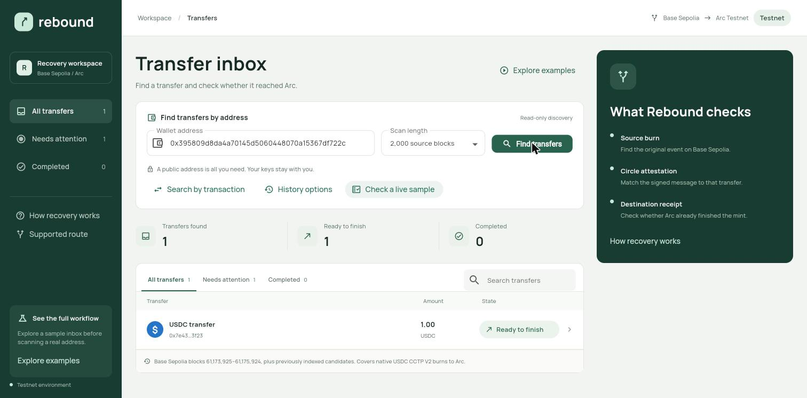
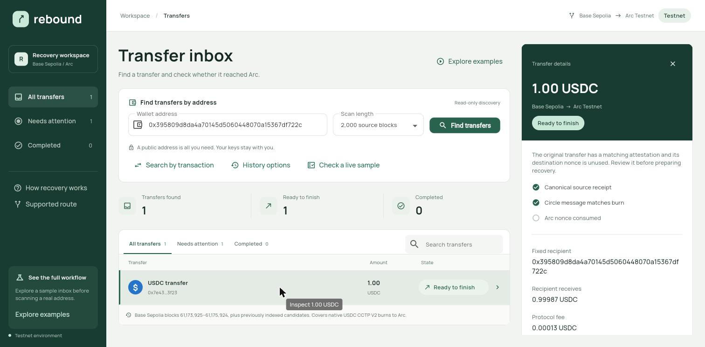
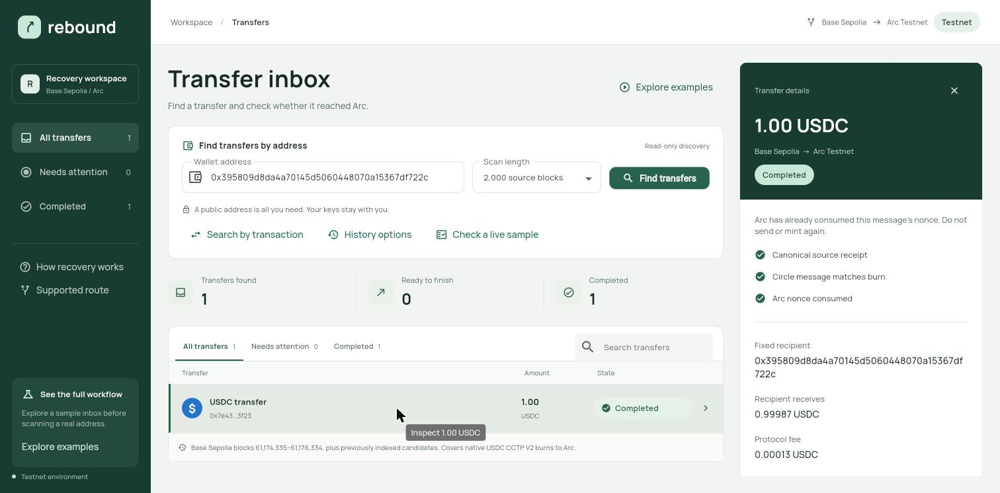

# First live recovery

November 20, 2026, 06:43–06:46 UTC. A controlled Base Sepolia → Arc Testnet transfer was interrupted on purpose, found by wallet address in a fresh Rebound session, finished with `rebound.cli recover`, and then refused on a second attempt. Every hash below can be checked on a public explorer.

This covers the first four items under README **Final release gates**: controlled source burn, fresh-session discovery, actual destination mint and second attempt blocked. Browser wallet signing, public hosting and the QuickNode delivery gate are separate.

## Summary

| Step | Evidence |
|---|---|
| Controlled source burn | [Base Sepolia `0x7e43…3f23`](https://sepolia.basescan.org/tx/0x7e4334109c120f9da71e01116190804a9d91f2fd5ec07cfd7196a649e68e3f23), log 4, block 61,175,721, 06:43:33 UTC |
| Fresh-session discovery | Empty `REBOUND_DB`, wallet address only, 2,000-block scan → **Ready to finish** |
| Destination mint | [Arc Testnet `0x9202…a0a5`](https://explorer.testnet.arc.io/tx/0x92020b4554591c5afc4ae31aff0a8906fc19d1a17f2bd1773e1592762ea0a0a5), block 73,147,365, 06:45:12 UTC, status `0x1` |
| Refreshed inbox | Same address rescanned → **Completed**, Arc nonce consumed |
| Second attempt | `prepare` on the same hash and log: "Transfer is completed. Arc has already consumed this message's nonce. Do not send or mint again." No transaction prepared |

The burn and the mint are 99 seconds apart, including the manual review steps.

## 1. Controlled source burn

A throwaway testnet wallet, `0x395809d8da4a70145d5060448070a15367df722c`, was funded from Circle's faucet (Base Sepolia and Arc Testnet USDC) and the Coinbase Developer Platform faucet (Base Sepolia ETH). It holds no mainnet assets. Its key was entered only at hidden local prompts and is not in this repository.

```sh
W=0x395809d8da4a70145d5060448070a15367df722c
uv run python -m rebound.lab interrupt --amount 1 --recipient $W --sender $W
```

| Field | Value |
|---|---|
| Approve | [`0x0940…8be4`](https://sepolia.basescan.org/tx/0x09409e1fac4abf234c38e76d3a15a9023b91648e1bf800325c008295ef378be4), exact 1 USDC allowance, block 61,175,708 |
| Burn | `0x7e4334109c120f9da71e01116190804a9d91f2fd5ec07cfd7196a649e68e3f23`, log 4, block hash `0xda6e050f3ba09ac5a88875ba21f9bd7c6c6dd30f569f0b5a4f9a6490e713f39c` |
| Amount | 1 USDC, canonical Base Sepolia USDC |
| Max fee | 0.000156 USDC (Circle quote 1.3 bps plus a 20% buffer) |
| Finality threshold | 1000 (fast) |
| Destination | Arc Testnet, CCTP domain 26 |
| Recipient | the same wallet |
| destinationCaller | zero (anyone may submit) |
| Hook | none (plain `depositForBurn`, no Circle forwarding) |

The lab decoded the receipt's `DepositForBurn` event and confirmed every field before printing the hash. It never calls `receiveMessage`.

## 2. Fresh-session discovery

Rebound was started from `main` at `1696eb8` with a new, empty database. The browser received only the public wallet address.

```sh
REBOUND_DB=data/fresh.sqlite3 uv run uvicorn rebound.app:app --host 127.0.0.1 --port 8765
```

The scan covered Base Sepolia blocks 61,173,925–61,175,924 and returned one transfer, **Ready to finish**. The inspector showed a canonical source receipt and a Circle message that matches the burn, with the Arc nonce still unused. It reported 0.99987 USDC to the fixed recipient and a 0.00013 USDC protocol fee.





## 3. Destination mint

```sh
uv run python -m rebound.cli recover 0x7e4334109c120f9da71e01116190804a9d91f2fd5ec07cfd7196a649e68e3f23 4 --caller 0x395809d8da4a70145d5060448070a15367df722c
```

The command printed the review before asking for anything: fixed recipient, 1 USDC original amount, 0.99987 USDC to the recipient, 0.00013 USDC protocol fee, an estimated maximum gas cost of 0.005351325 testnet USDC and the 0.1 USDC local cap. It required typing `RECOVER`, read the key at a hidden prompt and signed once.

| Field | Value |
|---|---|
| Destination transaction | `0x92020b4554591c5afc4ae31aff0a8906fc19d1a17f2bd1773e1592762ea0a0a5` |
| Arc block | 73,147,365 |
| Receipt status | `0x1` |
| Gas | 175,814 gas, 0.00439535 testnet USDC |
| `MessageReceived` nonce | `0xeafbcb86f92955da10623109d1fb9196e5dd2704cfcadc8620f0022f8a5670cd` |
| `MessageReceived` caller | `0x395809d8da4a70145d5060448070a15367df722c` |
| Finality executed | 1000 |

The command matched the receipt's `MessageReceived` event to the original message body and nonce before reporting success. The Arc receipt status was also checked independently over JSON-RPC.

## 4. Refresh and second attempt

The same wallet was rescanned in the same browser session (blocks 61,174,335–61,176,334). The transfer now shows **Completed**, with all three checks passing, including "Arc nonce consumed".



```sh
uv run python -m rebound.cli prepare 0x7e4334109c120f9da71e01116190804a9d91f2fd5ec07cfd7196a649e68e3f23 4 --caller 0x395809d8da4a70145d5060448070a15367df722c
```

```text
Transfer is completed. Arc has already consumed this message's nonce. Do not send or mint again.
```

No second transaction was prepared, signed or broadcast.

## Scope

- This is one testnet transfer on the supported route. It does not show mainnet recovery, coverage of other routes or user demand.
- The interruption was deliberate: the lab burn stops before the mint. It is not a failed third-party bridge session.
- Finishing used the local CLI. Browser wallet signing is a separate release gate.
- Attested messages can expire. A live pitch on another day should use a fresh controlled burn made that day.
